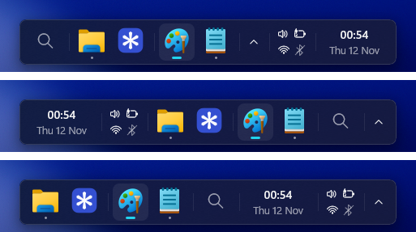
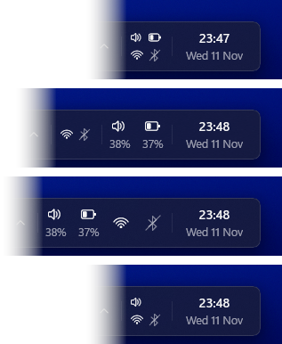
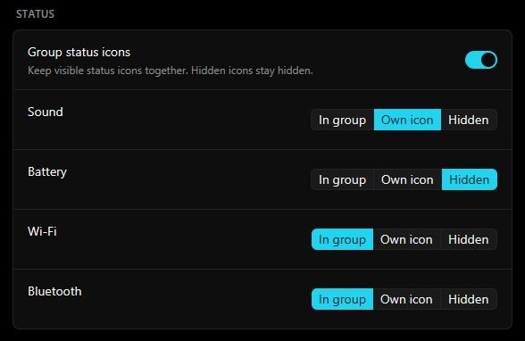

# Changelog

User-facing changes in each release. Each release on GitHub lists these notes and its pull requests.

## Unreleased

### New

- Type `wisp` or `settings` in the launcher to open Wisp's Settings, also while the taskbar and its tray icon are hidden. (#86)
- Find Windows tools by their program name, such as `cmd`, `taskmgr` or `regedit`, whatever the language of Windows. (#89, fixes #84)
- Right-click an app in the dock for its Jump List: its recent files and its own tasks, as on the taskbar. (#PR, fixes #74)
- Open or close the launcher by tapping the Windows key alone. Turn on Use Win key in Settings, under Shortcut; it replaces your shortcut, and Windows shortcuts such as Win+E still work. (#80)
- Hide the search button in the dock: turn off Search button in Settings, under Dock, or set `dock_search_button = false`. Your shortcut still opens the launcher. (#81, by @SorbetMango, fixes #79; #82)
- Turn Night Light on or off and switch Windows between dark and light mode from the launcher: type `theme`, `dark` or `light` for one toggle. Minimize, maximize, restore, close or keep on top the window you opened it over. (#76, #78, fixes #62)
- Wisp checks daily for stable updates and shows a notification once per version, with an update row in the launcher. Turn checks off in Settings. Metered connections and Nightly builds skip checks. (#77, fixes #43)
- Choose a color for the dock and the launcher in Settings, under Appearance > Advanced. Turn on Custom dock color, then pick a preset, set hue, saturation, lightness and alpha, or type a hex value or red, green and blue numbers. Text turns light or dark to stay readable, and with Acrylic the color's alpha sets how much of the theme's acrylic shows through. Turning the switch off returns to the theme's colors. (#72, by @Kendoismebutmaybenot, fixes #60)
- A dock app's right-click menu shows an arrow beside its name, opening New window, Run as administrator, Open file location and Properties. Pin to dock or Unpin from dock stays in the main menu. Close window or Close all windows shows when the app has windows, and End task shows when it is turned on for the taskbar in Windows Settings (System > For developers). Items that don't apply are hidden. (#73, by @Kendoismebutmaybenot)

### Fixes

- Hibernate from the launcher when the PC supports hibernation and has a hibernation file. (#87, fixes #83)
- Pressing a toggle in the launcher many times in a row, such as Bluetooth, Wi-Fi, dark mode or play/pause, no longer keeps Windows switching for seconds afterwards: only the last press is applied. (#78)
- Keep the launcher's backdrop and border consistent at the bottom and center of the screen, in both light and dark themes. (#75, fixes #45)
- Windows Terminal and other Microsoft Store apps whose windows don't name their app now group with their pinned icon, and start from the dock. Before, a pinned Terminal did nothing when clicked. Pins made from such an app move to it on their own. (#73, by @Kendoismebutmaybenot)

## 0.7.0 - 2026-11-12

### New

- **Arrange the dock your way.** Drag the launcher, apps, notification icons, status and clock to any place in the dock. The order is saved. (#65)

  

- **Choose your status icons.** Sound, battery, Wi-Fi and Bluetooth sit together in one 2x2 group. Hover for details, scroll over sound to change the volume, click to open Now. Each can stay in the group, get its own icon, or be hidden: in Settings, under Status. Own sound and battery icons show their percentage, and Wi-Fi shows its signal. (#64, #66, #67)

  

  

- **Pin apps to the dock.** Right-click an app and choose Pin to dock. Pinned apps stay in the dock, before running apps, and start with a click. (#54, by @SorbetMango, fixes #31)
- **Rearrange apps by dragging.** Drop an app among the pinned apps to pin it there, or among the running apps to unpin it. (#65, by @SorbetMango, fixes #32)
- **Wi-Fi and Bluetooth in Now.** Pick a network to connect, entering its password right there, or a Bluetooth audio device to connect or disconnect it. Turn Wi-Fi and Bluetooth on or off. Type "wifi" or "bluetooth" in the launcher to go straight there. (#68)
- Apps with more than one window open show a second dot under their dock icon. (#55)
- The autohide dock starts to slide in sooner when you move the pointer to the bottom edge. (#25, by @RayTrunk, fixes #20)

### Thanks

@SorbetMango contributed their first pull request to Wisp in this release, and the dragging in #65 started from their fork.

## 0.6.1 - 2026-11-09

### Fixes

- The release zip has Wisp's files at its top level, so the install path stays the same across updates. (#50)
- Wisp installed with winget updates through `winget upgrade` instead of the Update button in Settings. (#50)

## 0.6.0 - 2026-11-09

### New

- **See an app's windows.** Hover an app with several windows to list them. Click one to switch to it, or middle-click to close it. (#21, by @JulienMaille)
- **Choose the dock's size.** Set the app icon size in Settings, from 24 to 40. The dock's height, spacing and status area scale with it. (#39, by @JulienMaille)

### Fixes

- Wisp hides the taskbar reliably when it starts. Before, the taskbar sometimes stayed visible for several seconds, especially with a second screen. (#30, by @RayTrunk, fixes #28)
- The Windows taskbar no longer flashes when you switch the dock between autohide and Keep the dock visible. (#24, by @RayTrunk, fixes #18)
- Notification icons keep reaching Wisp when Explorer shows its taskbar. (#38, fixes #19)
- Right-clicking the dock no longer shows a "Wisp" title strip across its top. (#34, by @RayTrunk, fixes #33)
- The best match stays selected while typing in the launcher when the mouse rests over the results. Move the mouse to highlight another result. (#36, fixes #35)
- Time searches now find English city names on non-English Windows, while still finding names in the Windows display language. (#37, fixes #26)
- The settings app is a third smaller to download (15.2 MB → 10.0 MB). (#46)
- Updates download the release zip, and Wisp tells you where to get Settings if it is missing. (#47)

## 0.5.0 - 2026-11-07

### New

- **Keep the dock visible.** A new option in Settings keeps the dock on screen and reserves its space, so maximized windows stop above it instead of going behind it. Full-screen apps still hide it, including apps that go full screen from a maximized window. (#9)
- **Click the app in front to minimize it**, like a taskbar button. Click it again to bring it back. (#14, by @JulienMaille)

### Fixes

- Wisp now hides the taskbar when you start it from the Start menu. Before, it could fail with "Could not find primary taskbar". (#8)
- Clicking an app in the dock now switches to it while Action Center, Start or search is open. (#13, by @JulienMaille, fixes #11)
- Dock icons keep their place when clicked instead of moving to the front. (#5, by @JulienMaille)
- Tray icons are sharp instead of pixelated. (#3, by @JulienMaille, fixes #2)
- Windows 10: icons and text use the Windows 10 fonts instead of drawing as boxes. (#10, for #1)
- The tray no longer comes up empty after starting Wisp from the Start menu. (#9)
- Turning "Keep the dock visible" on or off no longer freezes the dock and launcher for up to two seconds. (#9)
- Taskbar hiding retries reliably after Explorer restarts and display changes. (#8)
- An icon no longer stays raised after hovering the hidden-icons arrow. (#16)
- The "Show hidden icons" tooltip no longer covers its own flyout. (#17)
- Configs from older versions pick up new settings from the defaults. Configs from Wisp 0.3 keep the taskbar as before. (#8)

### Thanks

@JulienMaille contributed their first pull requests to Wisp in this release: #3, #5, #13 and #14.

## Earlier releases

See the [releases page](https://github.com/SumirSeth/wisp/releases) for 0.4.2 and earlier.
