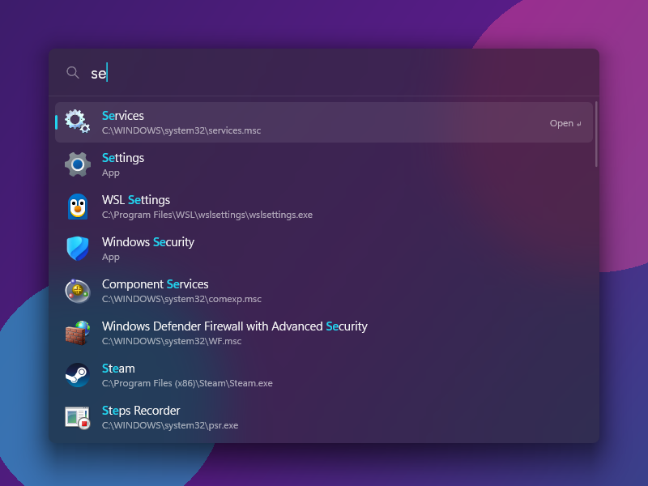
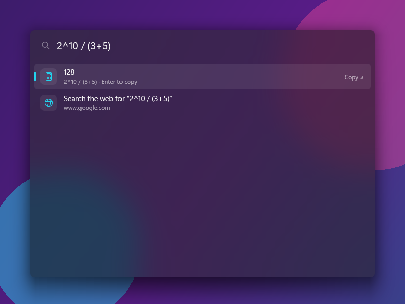

<p align="center">
  
</p>

<h1 align="center">Wisp</h1>

<p align="center">
  <b>An app launcher for Windows.</b><br>
  Runs without PowerToys as one ~0.8 MB executable.
</p>

<p align="center">
  <a href="https://github.com/SumirSeth/wisp/releases/latest"></a>
  <a href="https://github.com/SumirSeth/wisp/actions/workflows/ci.yml"></a>
  <a href="LICENSE"></a>
  
</p>

<p align="center">
  
</p>

Press <kbd>Alt</kbd>+<kbd>Space</kbd>, type an app name, then press <kbd>Enter</kbd>. Wisp uses Rust, Win32, Direct2D and DirectWrite. It needs no .NET runtime, web view, UI framework or PowerToys install.

## Benchmarks

Wisp 0.2.0 and PowerToys Run 0.94 ran on the same machine (i5-12500H, 144 Hz display), with 30 trials each. PowerToys Run used its default config. Each typing trial typed a whole app name, such as `notepad` or `terminal`. Times are median / p90:

| | **Wisp** | PowerToys Run | |
| --- | --- | --- | --- |
| Typing → first results | **24 / 37 ms** | 200 / 232 ms | **~8× faster** |
| Typing → results settled | **188 / 265 ms** | 437 / 544 ms | **~2.3× faster** |
| Shortcut → launcher drawn | **15 / 18 ms** | 30 / 38 ms | **2× faster** |
| Memory (private bytes) | **20 MB** | 290 MB + 12 MB PowerToys host | **~14× less memory** |
| Download / install size | **0.8 MB** | 794 MB (PowerToys install) | |
| Threads | **18** | 49 | |

Wisp's settled time includes its file results, which arrive after the app results.

[`bench/bench.ps1`](bench/bench.ps1) measures both launchers from outside their processes. It sends keystrokes and polls the screen for visible changes. The times include search, rendering and compositor time. Both launchers run over the same static backdrop window. The benchmark ignores changes below its visibility threshold. See [`bench/RESULTS.md`](bench/RESULTS.md) for the full results and earlier runs, or run the script on your machine.

> [!NOTE]
> With the default acrylic backdrop, Wisp's launcher and results appear in ~15 ms. Windows then fades in the blur over ~0.25 s, as it does for the Start menu. PowerToys Run's backdrop settles in ~42 ms. Set `backdrop = "solid"` to remove the fade-in. The launcher then draws fully in ~25 ms.

## Features

- **App search**: desktop and Microsoft Store apps from Start's "All apps", with their icons. Wisp excludes uninstallers, documents and web links.
- **Fuzzy search** uses [nucleo](https://github.com/helix-editor/nucleo), the Helix editor's matcher. `vsc` finds **V**isual **S**tudio **C**ode. Wisp rejects scattered matches such as `code` for Recorder.
- **File search**: Wisp searches file and folder names in the Windows Search index. For queries of 3 or more characters, up to 5 files appear after the apps. Start a query with `?` to search files only. Wisp skips dependency and cache folders such as `node_modules`, and any file or folder whose name starts with a dot. It ranks files in Desktop, Documents, Downloads, Pictures, Videos, Music and OneDrive higher.
- **Launch history**: frequently and recently launched apps rank higher. Wisp lists them when the search box is empty.
- **Calculator**: `sqrt(2) * 10`, `2^10`, `(3 + 4) % 5`, `2pi + 1`. Press <kbd>Enter</kbd> to copy the result.
- **Shell commands**: `> ipconfig /all` runs in Command Prompt.
- **URLs and web search**: open `https://…` and `www.…` links in your browser, or search the web for the query.
- **Appearance**: acrylic backdrop, rounded corners, light and dark themes that follow Windows, and drawing that scales with display DPI.
- **Idle CPU use**: 0–16 ms of CPU time in the 10 s benchmark. Windows reports CPU time in steps of 15.6 ms. Worker threads index apps, query the file index and load icons.

<p align="center">
  
</p>

## Wisp vs PowerToys Run

**Only in Wisp**

- Runs on its own as one portable `.exe`, with no PowerToys install and no .NET runtime. The settings app is a separate, optional `.exe`.
- Searches on each keystroke without an input delay. PowerToys Run waits 50–150 ms after you type before it searches.
- fzf-style query operators: `^start`, `end$`, `'exact`, `!exclude`.
- Lists recently launched apps when the search box is empty.
- Skips dependency and cache folders in file results, with a configurable list.
- Stores the config as plain-text TOML that you can keep with your dotfiles.

**In both**

- App search with icons and fuzzy matching, with frequently launched apps ranked higher
- File search through the Windows Search index, also with the `?` prefix
- Calculator, web search, URLs, shell commands
- Run as administrator, open the file location
- Light and dark themes, multiple monitors, per-monitor DPI
- A settings window

**Only in PowerToys Run** (planned for Wisp)

- Switching between open windows (Window Walker)
- System commands (shut down, sleep, lock, empty Recycle Bin)
- Unit conversion, time and date, value generation (GUIDs, hashes, Base64)
- Windows Settings, services and registry search, folder browsing
- VS Code workspaces, Windows Terminal profiles, OneNote
- Third-party plugins and plugin action keywords

## Install

1. Download `wisp-vX.Y.Z-x86_64-windows.zip` from the [latest release](https://github.com/SumirSeth/wisp/releases/latest). Extract it anywhere, for example to `%LOCALAPPDATA%\Programs\Wisp`. The zip contains `wisp.exe` (the launcher) and `wisp-settings.exe` (the settings app).
2. Run `wisp.exe`. Wisp starts in the system tray. On the first run, the settings app opens and helps you choose a shortcut and turn on **Start with Windows**.
3. Press <kbd>Alt</kbd>+<kbd>Space</kbd>.

To use the launcher only, download `wisp-vX.Y.Z-x86_64.exe` instead. Without the settings app, the tray menu's **Settings** item opens the config file.

### Update

The settings app checks GitHub for a newer release when it opens. If one exists, the sidebar shows **Wisp X.Y.Z is available**. Select **Update** on the **About** page. The app downloads the new `wisp.exe` and `wisp-settings.exe`, checks them against the release's `SHA256SUMS.txt`, replaces the old files and restarts the launcher. Then select **Restart** to open the new settings app. Your config file does not change.

Wisp must be in a folder you can write to, such as `%LOCALAPPDATA%\Programs\Wisp`. Otherwise, download the new zip and replace the files yourself.

> [!NOTE]
> PowerToys Run also uses <kbd>Alt</kbd>+<kbd>Space</kbd>. Only one app can register a given shortcut. Turn off PowerToys Run in PowerToys Settings, or change Wisp's `hotkey` (see [Config](#config)). Wisp shows a notification if another app uses its shortcut.

> [!NOTE]
> Release builds are not code-signed. Windows SmartScreen may warn you the first time you run Wisp. Choose **More info → Run anyway**, or [build from source](#building-from-source).

## Usage

| Keys | Action |
| --- | --- |
| <kbd>Alt</kbd>+<kbd>Space</kbd> | Show or hide the launcher |
| <kbd>Enter</kbd> | Open an app or URL, copy a calculator result, run a command, or search the web |
| <kbd>Ctrl</kbd>+<kbd>Shift</kbd>+<kbd>Enter</kbd> | Run as administrator |
| <kbd>Ctrl</kbd>+<kbd>Shift</kbd>+<kbd>E</kbd> | Show the app, file or folder in File Explorer |
| <kbd>Ctrl</kbd>+<kbd>Shift</kbd>+<kbd>C</kbd> | Copy the path of the app, file or folder |
| <kbd>↑</kbd> <kbd>↓</kbd> · <kbd>Tab</kbd> · <kbd>PgUp</kbd> <kbd>PgDn</kbd> · mouse wheel | Move the selection |
| <kbd>Ctrl</kbd>+<kbd>C</kbd> | Copy the selected text, or the calculator result |
| <kbd>Esc</kbd> | Hide the launcher |

In the search box, press <kbd>Ctrl</kbd>+<kbd>←</kbd> or <kbd>Ctrl</kbd>+<kbd>→</kbd> to move by word. Press <kbd>Ctrl</kbd>+<kbd>Backspace</kbd> to delete a word. Hold <kbd>Shift</kbd> while moving to select text. Use <kbd>Ctrl</kbd>+<kbd>A</kbd> to select all, <kbd>Ctrl</kbd>+<kbd>V</kbd> to paste, and <kbd>Ctrl</kbd>+<kbd>X</kbd> to cut.

| Type | Get |
| --- | --- |
| `code` | Apps matching "code", then files whose names start with "code" |
| `?invoice` | Files and folders only |
| `^vis` · `term$` · `'note` · `!edge` | Starts with · ends with · exact substring · exclude |
| `12 * (3 + 4)` | Calculator result (<kbd>Enter</kbd> copies it) |
| `> winget upgrade` | Run in Command Prompt |
| `https://…` or `www.…` | Open in your browser |
| anything else | "Search the web for …" |

Run `wisp.exe --show` to show the launcher in the running instance, or start one with the launcher visible. Run `wisp.exe --quit` to stop the running instance. Only one instance runs at a time.

## Config

Choose **Settings** in the tray menu to change settings in a window. Changes apply immediately, and the settings app keeps the comments in your config file.

You can also choose **Edit config file** in the tray menu, or edit `%APPDATA%\wisp\config.toml` directly. Wisp creates this file with comments on first run. Changes to the file apply the next time the launcher opens.

```toml
hotkey = "Alt+Space"        # examples: "Ctrl+Shift+Space", "Win+Alt+W", "Ctrl+F12"
max_results = 8             # results visible at once; scroll to see more
theme = "system"            # "system" | "dark" | "light"
backdrop = "acrylic"        # "acrylic" | "mica" | "solid"
show_recent = true          # recently launched apps when the search box is empty
search_url = "https://www.google.com/search?q={query}"
file_search = true          # search the Windows Search index; prefix a query with ? for files only
file_search_exclude = ["node_modules", "AppData", "site-packages", "__pycache__", "venv", "target", "dist", "build", "Cache", "Code Cache", "GPUCache", "Service Worker", "IndexedDB", "Extensions"]
```

Wisp stores launch history in `history.toml` beside the config. It uses this history to rank apps.

## Building from source

Install [Rust](https://rustup.rs) (stable, MSVC toolchain) and the Windows SDK from Visual Studio Build Tools.

```sh
git clone https://github.com/SumirSeth/wisp
cd wisp
cargo build --release --workspace   # → target/release/wisp.exe and wisp-settings.exe
cargo test --workspace
```

The first build of the settings app takes several minutes, because it compiles the GPUI UI framework. To build only the launcher, run `cargo build --release -p wisp`.

Debug builds of the launcher keep a console window open for logs. Release builds run without one.

## How it works

| File | What it does |
| --- | --- |
| [`src/app.rs`](src/app.rs) | Launcher, message loop, keyboard and mouse input, showing and hiding |
| [`src/render.rs`](src/render.rs) | Direct2D/DirectWrite drawing and layout |
| [`src/search.rs`](src/search.rs) | Ranks app, calculator, URL, command and web search results |
| [`src/indexer.rs`](src/indexer.rs) | Indexes apps and loads icons from `shell:AppsFolder` on a worker thread |
| [`src/files.rs`](src/files.rs) | Queries the Windows Search index for files over OLE DB on a worker thread |
| [`src/calc.rs`](src/calc.rs) | Calculator expression parser |
| [`src/editor.rs`](src/editor.rs) | Text editing for the search box |
| [`src/launch.rs`](src/launch.rs) | Opens apps and URLs and runs commands through the Windows shell |
| [`src/tray.rs`](src/tray.rs) | Tray icon, menu and notifications |
| [`src/config.rs`](src/config.rs), [`src/history.rs`](src/history.rs) | Config and launch history |
| [`settings/`](settings) | The settings app: onboarding and a settings window, built with [GPUI](https://www.gpui.rs) and [GPUI Component](https://github.com/longbridge/gpui-component) |

- **Apps come from `shell:AppsFolder`**, the source for Start's "All apps". One scan covers desktop and Microsoft Store apps. Wisp uses the Windows shell to open both.
- **File search queries the Windows Search index directly** through OLE DB, as PowerToys Run does. A new query takes about 100–160 ms. It runs on a worker thread, so app results appear first and file results follow. The worker sends results before it loads icons for new file types. When you type faster than queries finish, the worker skips to the latest query.
- **Direct2D uses software rendering.** At this window size, a frame takes about 1 ms of CPU time. Avoiding the GPU driver saves about 30 MB of private memory.
- **The launcher window keeps its caption style but removes the visible frame** (`WM_NCCALCSIZE`). DWM needs the frame style to render acrylic. A borderless popup gets a flat grey backdrop.
- **The launcher keeps a fixed height while results are present.** Resizing a window with an acrylic or mica backdrop makes DWM recalculate the blur. It takes about 250 ms to settle. At a fixed height, each keystroke needs one repaint.

## Contributing

Before opening a pull request, run `cargo fmt --all --check`, `cargo clippy --workspace --all-targets -- -D warnings` and `cargo test --workspace`. CI runs these checks. For changes that affect performance, include measurements from `bench/bench.ps1` before and after the change. Report bugs and request features through GitHub issues.

## License

[MIT](LICENSE) © Sumir Seth
